# Release E2E evidence snapshot — 26 October 2026

This is a finite snapshot of the local checks reported for the Trust release work as of 26 October 2026. Build 49 commit `2561ba8` is archived, Apple-validated, and uploaded for TestFlight. This is not a release approval and does not mean every external integration passed. Full simulator logs and `.xcresult` bundles remain on the test Mac under `/tmp/trust-e2e-20261025/`.

## Results recorded

| Area | Result | Scope and interpretation |
| --- | --- | --- |
| TestFlight build 49 | `VALID / APP_STORE_ELIGIBLE`; internal `IN_BETA_TESTING`, external `READY_FOR_BETA_SUBMISSION` | Checked at 2026-10-26 19:32:27 UTC. Delivery ID `444aead0-f608-4fc2-85f0-b27fd284274a`; auto-notify enabled and in `Trust Family Auto`. App Store draft remains manual with build 47 selected. |
| Build 49 archive, validation, and upload | Upload exit 0; Apple validation exit 0 | Commit `2561ba8`. Archive `/Users/juanquirino/Library/Developer/Xcode/Archives/2026-10-26/Trust-1.0-49-AppStore.xcarchive`; ReleaseEvidence `/Users/juanquirino/Library/Developer/Xcode/Archives/2026-10-26/Trust-1.0-49-ReleaseEvidence`; IPA SHA-256 `f80547d5887c7be5d9beacc6ce8d1e4ed22f561a07dc6878f33a4b7bf68004bd`. Audits confirmed production API, phone bypass off, production APNs, `get-task-allow=false`, age entitlement, matching privacy manifest, and regular App Store eligibility. |
| Trust API/PostgreSQL tests | 216/216 passed | Fresh build-49-source rerun against PostgreSQL; result: `/tmp/trust-e2e-20261025/api-49-final/api-49-final.trx`. |
| Fictional-account HTTP scenarios | 41/41 passed | `apps/trust-api/scripts/e2e_two_account_http.py` against the isolated local API and a fresh runner-owned PostgreSQL database, using fictional Development accounts and OTP. It covers phone-consent/OTP ownership, invite and connection, privacy/sharing, locations/History/Look, Pause/Stop/remove, profile/input validation, and account deletion. Run log: `/tmp/trust-e2e-20261025/http-42-final/http.log`. This does not test carrier SMS or production accounts. |
| Broad standard build-48 UI attempt | 134 passed, 27 expected setup skips, 1 failure | The German Pause test failed because the native menu tap did not open the Pause sheet; no app callback occurred. The focused native-scroll rerun passed 1/0/0; the later first-open assertion is covered by the passing build-49 broad suite below. Log/result: `/tmp/trust-e2e-20261025/standard-current-48.log`, `/tmp/trust-e2e-20261025/standard-current-48/standard-ui.xcresult`. |
| Build-49 Pause UI | Standard and 375 pt: 1 passed / 0 skipped / 0 failed each | All six shipped languages passed with concise visible titles and full VoiceOver titles. Astra accepted both capture sets. Bundles: `pause-six-standard-49.xcresult` and `pause-six-375-49.xcresult`. |
| Broad standard build-49 UI suite | 135 passed / 27 expected named setup skips / 0 failed | Wrapper exited 0. Result: `/tmp/trust-e2e-20261025/standard-final-49/standard-ui.xcresult`. The 27 skips correspond to 23 standalone cases already exercised on frozen build-48 products, 3 Home handoff cases exercised separately, and 1 paired two-role story tracked separately. Skips are not passes. |
| Frozen iOS build 48 standalone real-API cases | 23/23 passed individually, each 1 passed / 0 skipped / 0 failed | Fresh local Development API and PostgreSQL database per case, loopback proxy, synthetic Development review-unlock fixture enabled. The source-defined stories cover account setup and recovery, discovery and requests, sharing/Pause/Stop/remove, stale and offline reconciliation, Look/History access, profile edits and privacy restrictions. The serial Home A/B/A and paired two-device scenarios are tracked separately below. This is local API/UI evidence, not StoreKit evidence. |
| Privacy race regression cases | 4/4 passed after the fixes | They were observed red before the fix and green afterward: delayed History after Stop/remove/reconnect; History closed during offline consent refresh; Look closed during offline consent refresh; offline peer removal reconciled after relaunch/reconnect. Green case records are in `/tmp/trust-e2e-20261025/privacy-green-results.json`; per-case `.xcresult` bundles are under `/tmp/trust-e2e-20261025/privacy-green-{1..4}/`. |
| Real APNs notification and tap | 1 passed / 0 skipped / 0 failed | Against a fresh native PostgreSQL database on loopback port 5434. Two unique viewers generated two Look event IDs; actual system notifications were observed in foreground and background, and tapping opened the correct visible receipt. No `simctl push` was used. Result: `/tmp/trust-e2e-20261025/real-apns-48-final/RealPushAPNS.xcresult`. |
| APNs denied-permission recovery | 1 passed / 0 skipped / 0 failed | Verified no registration acknowledgement while denied, enabled Allow Notifications in native Settings, returned to You with Allowed state and successful registration, delivered a genuine Apple Sandbox Look push, and tapped into its matching Activity receipt. No `simctl push`. Result: `/tmp/trust-e2e-20261025/real-apns-switch-recovery-49/RealPushAPNS.xcresult`. Astra accepted the four new captures. |
| Notifications UI at 375 pt, English and German XXL | 1 passed / 0 skipped / 0 failed | Build-48 capture showed action/status and unfragmented German legal footer; scroll viewport clipping kept content clear of the status bar. Build-49 recovery captures show denied/allowed states and the resulting Activity receipt, accepted by Astra. |
| Same-account Home A/B/A handoff | 3/3 phases passed, each 1/0/0 | Full completion evidence is under `handoff-complete-48/{case}/{case}.xcresult`. |
| Paired two-device lane | Passed | Deterministic handshake run wrapper exited 0; Alice and Bob each passed 1/0/0; controller log confirms all four stages completed. Results: `/tmp/trust-e2e-20261025/paired-handshake-49/paired-two-account/{alice,bob}/paired-{role}.xcresult`. The prior interrupted wrapper remains historical and is superseded by this complete result. |
| Remote PR CI | Check current PR head | Remote checks are separate from the local evidence in this snapshot. |

Other checks recorded for this session: API web tests 3/3; localization validation 547 keys across five locales; TrustCore 103 passing tests. Fresh Python helper checks passed using `python3 -m unittest discover -s apps/trust-ios/Scripts/tests -p 'test_*.py' -v` (29/29) and `python3 -m unittest discover -s apps/trust-api/scripts/tests -p 'test_*.py' -v` (10/10), including nested stage-snapshot isolation. These describe separate runs, not a combined release gate.

## Screenshots

These fourteen simulator captures are representative UI evidence. The people and places are fictional. The build-48 images show earlier Pause and Home/Away states; the build-49 Pause images show first-open titles in English and German at 375 pt. Two more images show the build-48 Notifications layout at 375 pt. The four initial APNs captures show foreground/background presentation and Activity routing; the four new build-49 captures show denied state, native Settings enabled, Allowed state, and recovery receipt routing. None establishes TestFlight or physical-device delivery.

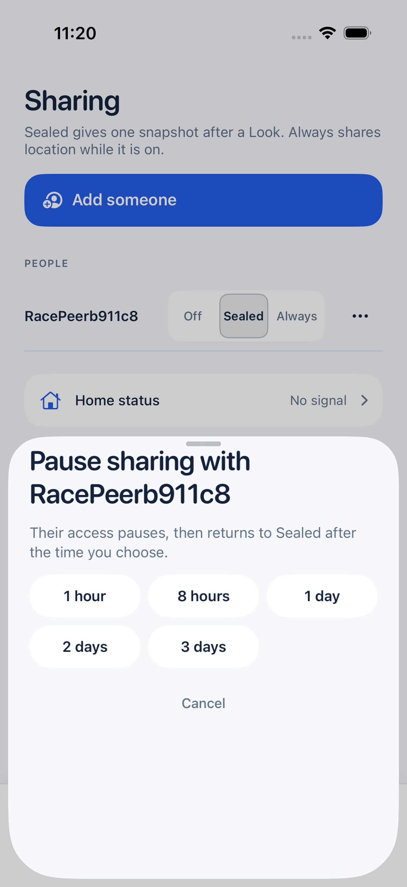

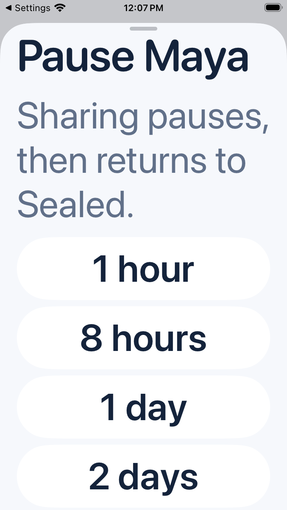

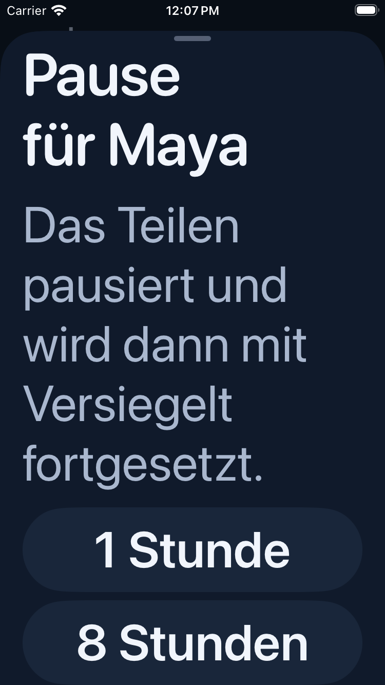

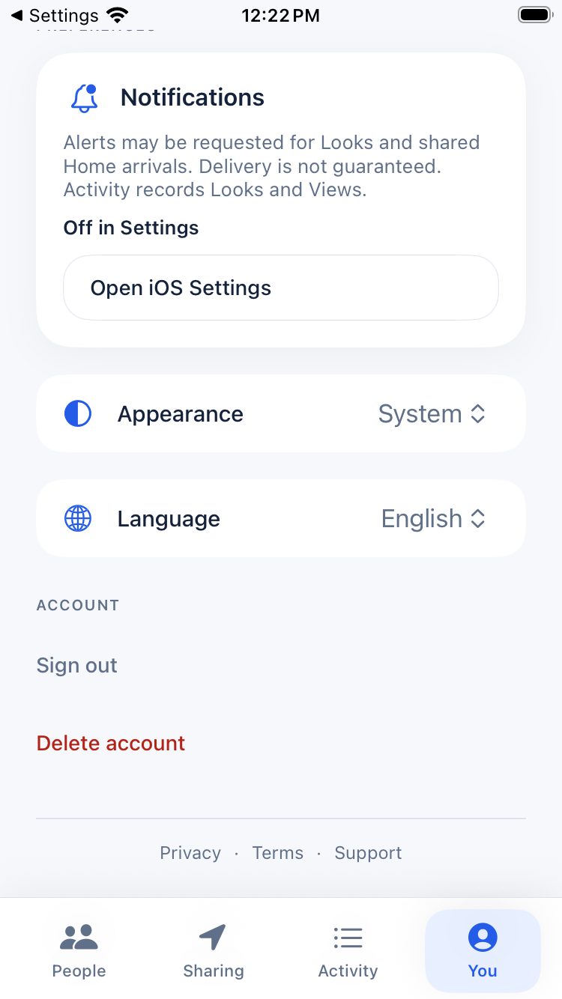

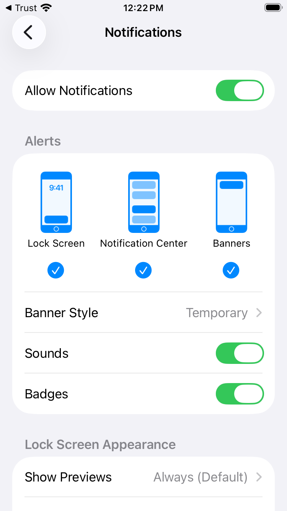

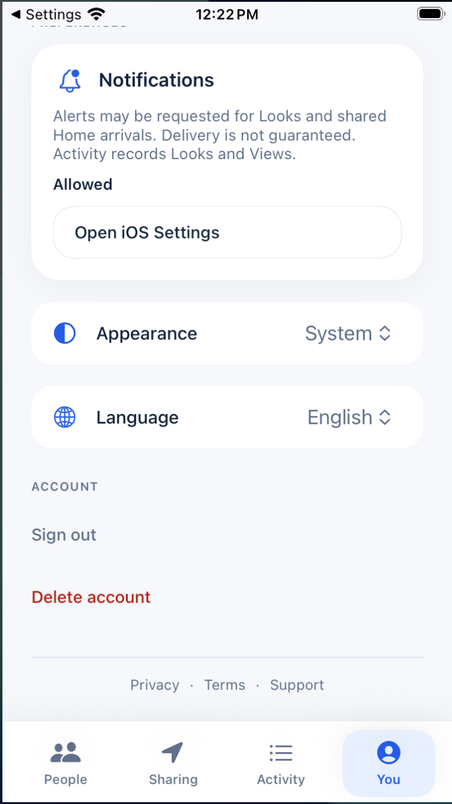

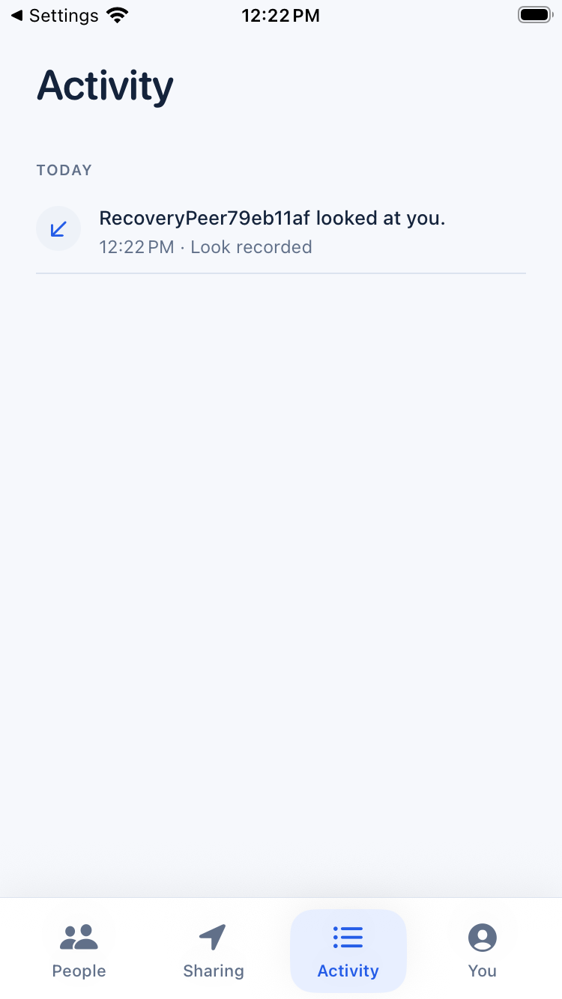

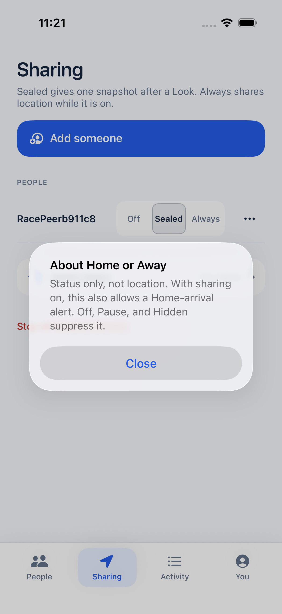

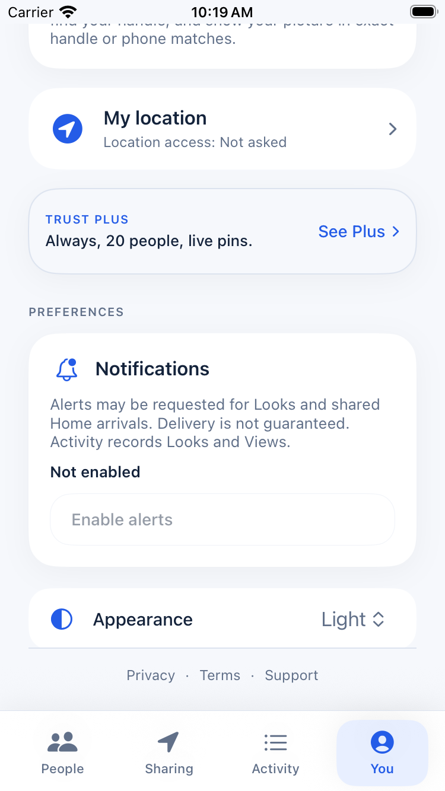

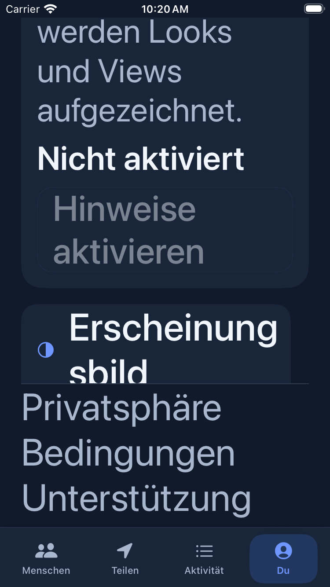

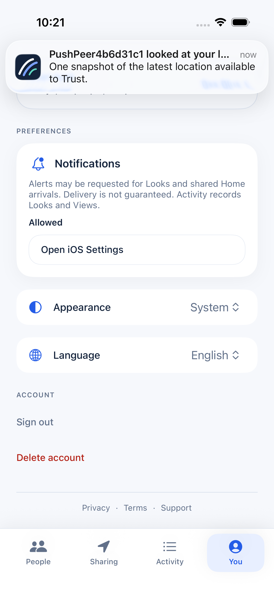

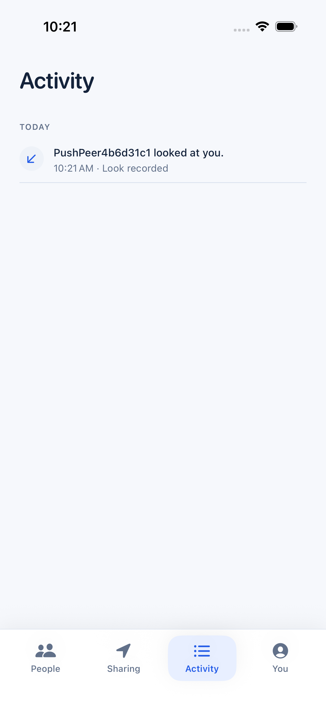

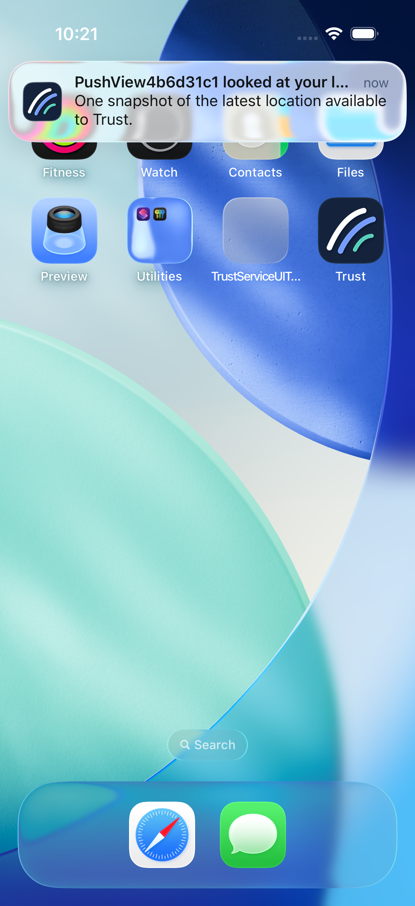

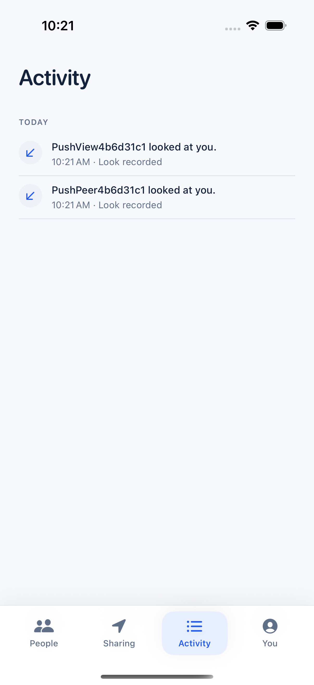

## Source and run limits

The build-48 broad standard attempt failed only in the German native menu tap; the Pause sheet did not open and no app callback occurred. Build-49 broad standard suite passed 135/162 with 27 expected named setup skips and no failures. The 27 skipped cases are 23 standalone cases exercised on frozen build-48 products, three separately exercised Home handoff cases, and the paired two-role story tracked separately. Build-49 standard and 375 pt Pause coverage passed in six languages, with Astra accepting both capture sets. A/B/A is complete, with all three phases passing. The full paired handshake lane passed with wrapper exit 0, both roles 1/0/0, and all four controller stages complete. Build-49 denied-permission APNs recovery passed 1/0/0 with a genuine push and correct receipt route. Inspect the current PR head for remote CI results; this snapshot records local evidence.

All API/UI cases used local Development services, fictional accounts and loopback endpoints. The enabled `StoreKit__AllowReviewUnlock` setting is a synthetic Development fixture, not an Apple purchase or entitlement verification. The HTTP fictional-account cases do not establish carrier SMS delivery.

This snapshot does **not** establish genuine Apple Sandbox in-app purchases or restores, Apple Sign In, carrier SMS, physical-device background location, TestFlight behavior, or production release readiness. The APNs result is limited to the simulator sandbox route exercised above. TestFlight in-app purchases use Apple’s IAP sandbox, while TestFlight push uses the production APNs environment; neither is evidenced by these local runs.

The full local-versus-Apple test boundary is documented in [SANDBOX.md](../../../apps/trust-ios/SANDBOX.md). The reusable orchestration guide is [LOCAL-TWO-ACCOUNT-E2E.md](../../LOCAL-TWO-ACCOUNT-E2E.md).
